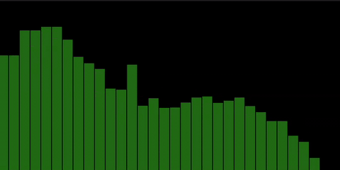
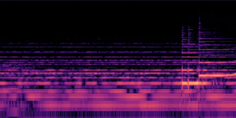
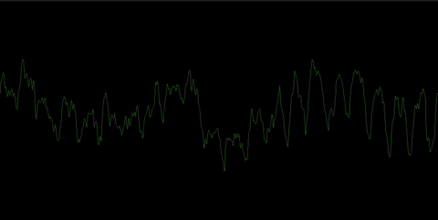
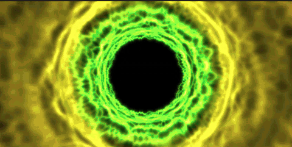

# loopviz

Real-time visualizer for system audio output, captured via loopback (PipeWire/PulseAudio monitor on Linux, BlackHole on macOS) and rendered with pygame or OpenGL.

| `spectrum` | `spectrogram` | `waveform` | `feedback` |
|---|---|---|---|
|  |  |  |  |
| log-spaced FFT bars | scrolling time-frequency image, one column per capture chunk | triggered oscilloscope trace, optional phosphor fade | MilkDrop-style frame feedback, shader warp on GPU, zoom/rotate on CPU |

## Setup

```bash
uv sync
```

- **Linux:** picks up the monitor source of the default output.
- **macOS:** no native loopback. `brew install blackhole-2ch`, then a Multi-Output Device (speakers + BlackHole) in Audio MIDI Setup as system output. Terminal needs mic permission. Volume keys don't work on Multi-Output, set per device.

## Usage

```bash
uv run loopviz --mode feedback
uv run loopviz --mode waveform --persistence 0.85
uv run loopviz --bands 64 --block-size 8192
uv run loopviz --palette green-glow
uv run loopviz --mode feedback --preset beat
uv run loopviz --backend cpu
uv run loopviz --list-devices
uv run loopviz --device "<name>"
```

`Tab` next mode, `C` palette (spectrum, waveform), `P` preset (feedback), `F` fullscreen, `Esc` quit.

## Notes

- Capture on a background thread, 512-sample chunks into a 2048-sample window. Keeps latency at about one chunk regardless of frame rate. Reading from the render loop drifted out of sync.
- Hann window, FFT, log-spaced bands (30 Hz to 16 kHz), dB mapped from -70..-10 to 0..1, attack/release smoothing.
- Bands below ~330 Hz get narrower than one FFT bin (21.5 Hz) at high band counts, so low bars repeat. `--block-size 4096/8192` fixes it at the cost of time resolution (93/186 ms window).
- GPU backend: OpenGL 3.3 core, forward-compatible for macOS. Non-GL renderers draw to an off-screen surface that's uploaded as a texture. `auto` falls back to CPU.
- GPU feedback ping-pongs between two RGBA16F targets. 8-bit fade gets stuck above black.
- Feedback presets: `tunnel` (continuous) and `beat` (kick onsets swell the zoom, flash the ring, flip spin every 16 beats). Beats are a fixed jump over the ~0.7 s bass average. Levels are already dB, so a ratio threshold barely triggered.
- Fullscreen uses desktop mode via `pygame.Window`. `toggle_fullscreen()` dropped the monitor to window resolution.
- New mode: renderer in `src/loopviz/renderers/`, register in `renderers/__init__.py`.
- Renderers can take extra keys through an optional `on_key(key)`. Palettes live in `palettes.py`.
